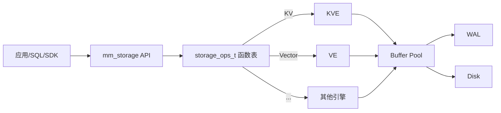

# 多模态数据库优化空间诊断 — 设计文档

> 日期：2026-10-16
> 状态：待用户审阅
> 前置文档：`docs/gap-analysis/2026-08-29-multimodal-db-gap-analysis.md`、`docs/db/MULTIMODAL-DB-ARCHITECTURE.md`、`docs/architecture/db/mm-storage/README.md`
> 范围：12 种 `DataModel` + Blob 引擎 + 协调层，共 13 项

---

## 一、执行摘要

本次诊断针对 `engineering/include/db/storage_engine.h` 中注册的 12 种数据模型，加上 Blob 引擎和协调层（`multimodal/`），共 13 个子系统。诊断基于源码扫描、既有 gap 分析文档（2026-08-29）、c9-2 known limitations 报告、以及测试结果综合而成。

### 1.1 关键结论（结论先行）

| 结论 | 严重度 | 涉及范围 |
|------|--------|----------|
| **持久化 / 崩溃恢复存在关键缺口** | 🔴 关键 | 全 13 模态（Vector 的 `vdb_chaos_test` 5 个失败全因于此；Vector 的 `vdb_e2e_test` 6 个失败中 2 个同因） |
| **分布式 / 分片 / 多副本缺位** | 🔴 关键 | 13/13 模态均无生产级实现（仅 KV 部分使用 shard） |
| **自动调参与自适应缺位** | 🟠 高 | 12/13（向量 HNSW 的 M/ef、时序压缩率、KV TTL 等需手动调） |
| **统一可观测性 / Metrics 缺位** | 🟠 高 | 13/13（GUC + workbench metrics 仅覆盖 web/workbench 子系统，未下沉到存储引擎） |
| **SIMD / 向量化执行缺位** | 🟡 中 | 5/13（Vector / KV / Timeseries / Spatial / Graph 的距离计算与扫描） |
| **测试基础设施不完整** | 🟠 高 | 13/13（vdb_e2e 6 + vdb_chaos 5 = 11 个失败；learning/ds-c / algo-c 缺测试） |

### 1.2 推荐优化路线（高层）

```
Phase 1（止血 + 闭环）   — 持久化 / WAL / Checkpoint 完整化、vdb_e2e / chaos 失败修复
Phase 2（核心能力升级）   — 分布式 KV 分片 + 多副本、向量 SIMD、自动调参框架
Phase 3（新能力扩展）     — 协调层跨模态事务、HNSW 增量构建、文档高级全文、时序 Lambda
```

### 1.3 文档结构

```
§1 执行摘要
§2 多模态全景地图
§3 横切共性优化（7 项）
§4 逐模态诊断（13 节 × 5 段式：现状/痛点/优化点/优先级/取舍）
§5 协调层诊断
§6 测试与稳定性短板
§7 优先级矩阵
§8 推荐优化路线
§9 附录：Relational 主线、参考实现、业界标杆
```

---

## 二、多模态全景地图

### 2.1 模态清单

| # | 模态 | 主目录 | 源文件数 | 实现成熟度 | 关键文件 |
|---|-------|--------|----------|------------|----------|
| 0 | Relational | `storage/rel/` | 5 | 高 | `rel.c` `table.c` `tid_resolver.c` `ltree.c` |
| 1 | KV | `storage/kv/` (+`lsm/`) | 8 | 中-高 | `kv_engine.c` `lsm_tree.c` `kv_ordered.c` `wide_row.c` |
| 2 | Graph | `storage/graph/` | 5 | 中 | `graph_engine.c` `graph_csr.c` `graph_traverse.c` `graph_index.c` `graph_store.c` |
| 3 | Vector | `storage/vector/` | 7 | 中-高 | `vector_engine.c` `vector_segment.c` `vector_buf.c` `vector_wal.c` `vector_index_persist.c` `vector_page.c` `graph_dedup.c` |
| 4 | Timeseries | `storage/ts/` | 11 | 中-高 | `ts_engine.c` `ts_segment.c` `ts_compress.c` `ts_continuous_agg.c` `ts_mview.c` `ts_retention.c` `ts_tag_index.c` `ts_partition.c` `ts_columnar.c` `ts_sql_functions.c` `ts_label_index.c` |
| 5 | Document | `storage/doc/` | 11 | 中-高 | `doc_engine.c` `doc_inverted.c` `bm25.c` `doc_fts.c` `doc_nested.c` `doc_vector.c` `doc_pipeline.c` `jsonpath.c` `doc_agg.c` `doc_highlight.c` `doc_field_boost.c` |
| 6 | Spatial | `storage/spatial/` | 7 | 中 | `spatial_engine.c` `rtree.c` `rtree_file.c` `spatial_geo.c` `spatial_quadtree.c` `geography.c` `spatial_functions.c` |
| 7 | Tree(Yang) | `storage/yang/` | 3 | 低-中 | `yang_engine.c` `yang_tree.c` `datastore.c` |
| 8 | Stream | `storage/stream/` | 1 | 🔴 骨架 | `stream_engine.c` `stream_engine.h` |
| 9 | Columnar | `storage/columnar/` | 1 | 🔴 骨架 | `columnar_engine.c` |
| 11 | RDF | `storage/rdf/` | 4 | 低-中 | `rdf_engine.c` `rdf_index.c` `sparql_parser.c` |
| 12 | Spatiotemporal | `storage/st/` | 1 | 🔴 骨架 | `st_engine.c` |
| + | Blob | `storage/blob/` | 8 | 中-高 | `blob_catalog.c` `blob_engine.c` `blob_upload.c` `blob_manifest.c` `blob_multipart.c` `blob_gc.c` `blob_reader_table.c` |
| 协 | Multimodal | `storage/multimodal/` | 4 | 中 | `cross_modal.c` `mm_hooks.c` `multimodal_object.c` `multimodal_search_v2.c` |

> **未在 DataModel 枚举但存在的子系统**（未注册进 `storage_ops_t`，独立目录）：
> - `storage/sparse/` — 稀疏向量 + BM25 混合检索（`bm25_index.c` `hybrid_retrieval.c` `sparse_vector.c`）
> - `storage/mmview/` — 多模态物化视图（`mview.c`）
> - `storage/cf/`（已不存在，合并入 `columnar/`）

### 2.2 统一抽象层



- **接口**：`storage_ops_t`（`engineering/include/db/storage_engine.h`）统一 14 个函数指针
- **注册**：`storage_register_engine(model, ops)`；13 模态均按此契约实现
- **协调**：`mm_context_t`（`mm_storage.h`）持有当前上下文
- **共享基础**：`Buffer Pool` + `WAL` + `Catalog`，但目前各引擎自行管理连接，复用不彻底

### 2.3 全景观察

- **核心 8 模态**（KV / Vector / Timeseries / Document / Spatial / Graph / Yang / Blob）：实装度中以上，是生产化重点
- **辅助 4 模态**（RDF / Spatiotemporal / Stream / Columnar）：1-4 文件骨架，需要决策"补齐 vs 暂缓"
- **协调层 / 共享基础**：`multimodal/` 与 `Buffer Pool / WAL` 是横向优化杠杆点
- **测试覆盖断层**：`vdb_e2e` + `vdb_chaos` 共 11 个失败用例为最显眼的稳定性短板

---

## 三、横切共性优化（7 项跨模态主题）

### 3.1 持久化与崩溃恢复 🔴 关键

**现状**：Buffer Pool + WAL + Page 三件套在 `storage/buffer/`、`storage/wal/`、`storage/page/` 已实现。`vector_wal.c`、`mvcc_wal.c`、`kv_txn.c` 等各引擎也实现了引擎级 WAL。

**痛点**：
- `vdb_e2e_test` 中 `LargeScalePersist` / `WALRecovery` / `CheckpointTest` 3 个失败直接归因于"未实现的 WAL/Checkpoint 持久化"
- `vdb_chaos_test` 中 `WriteKillRecovery` / `IndexRebuildAfterKill` / `MultipleCrashRecovery` / `ConcurrentWriteWithCrash` / `SaveLoadCorrectness` 5 个失败全部依赖"崩溃恢复路径"
- 各引擎 WAL 格式独立，无统一恢复框架

**优化点**：
1. 统一 WAL Record Header（`{LSN, xid, table_oid, page_id, prev_lsn, payload_len}`），便于跨模态恢复
2. 实现 `CheckpointManager`：周期触发 dirty page flush + WAL truncate，参考 PostgreSQL 检查点协议
3. 实现 `RecoveryEngine`：基于 LSN 起点 redo + undo，支持并行恢复
4. **Vector 引擎优先**：因 Chaos 测试暴露最严重
5. 测试夹具：模拟进程 kill（SIGKILL 等价），验证恢复

**优先级**：🔴 P0（直接解锁 11 个测试失败）

### 3.2 分布式 / 分片 / 多副本 🔴 关键

**现状**：
- `Phase 9 分布式演进`（已完成 260/260 任务）：`shard.h/c` + `dist_txn.h/c` + `raft.h/c` + `coordinator.h/c`
- 接入面：`engineering/src/sdk/core/{sharding,replication}.c`

**痛点**：
- 13 个模态中，仅 KV 在 SDK 层接入了分片 / 复制；其他模态均单节点
- 无水平扩展、无副本、无地理分布
- 单点容量 / 吞吐受限

**优化点**：
1. **以 KV 为模板**，将 sharding + Raft 模式推广到 Vector / Document / Timeseries
2. **模态特定分片键**：Vector → hash(embedding)，Document → _id / tenant_id，Timeseries → time + tag_hash
3. **副本 + 读扩展**：每个分片配 Raft Group；读流量走 follower（配置项）
4. **跨分片事务**：扩展 `dist_txn` 支持 2PC，参考 YugabyteDB
5. **分布式索引**：HNSW 跨分片（参考 Milvus QueryNode 架构）

**优先级**：🔴 P0（KV 已完成，其他模态是扩展工程）

### 3.3 自动调参与自适应 🟠 高

**现状**：所有模态的索引参数（HNSW 的 M / efConstruction / efSearch、IVF 的 nlist / nprobe、KV 的 compaction 触发阈值、Timeseries 的 partition 长度）均为手动配置。

**痛点**：
- 新手体验差：必须专家级理解才能调出好性能
- 自适应能力弱：数据分布变化时无重新调优
- 业界标杆：Milvus / Qdrant / Elastic 均提供 Auto-tune API

**优化点**：
1. **统一的 Auto-tune 框架** `autotune.h/c`：模型输入（数据分布 + 性能目标）→ 推荐参数
2. **在线指标采集**：查询延迟 P50/P99、recall@K、cache hit、compaction 频率
3. **HNSW 自动调参**：贝叶斯优化 + 安全护栏（参考 `DiskANN` 自动构建论文）
4. **Timeseries 自适应分区**：基于 cardinality 动态分裂 / 合并
5. **KV compaction 自适应**：基于 write amp 与 read amp 的反馈控制

**优先级**：🟠 P1（直接用户体验，长期价值）

### 3.4 统一可观测性 / Metrics 🟠 高

**现状**：
- GUC 配置系统（`db/core/guc.c`）
- workbench 微服务指标（Task 22-C 已落地 Prometheus metrics）
- 各引擎内部有 `get_stats()` 但口径不一致

**痛点**：
- 存储引擎 metrics 未下沉到 `mm_get_engine_stats()` 统一接口
- 各模态 stats 字段各异（`cache_hit_rate` 字段是 Vector / KV 有，TS 用 series count，Graph 用 vertex count）
- 无 P99/P95 延迟、无 IO 延迟细粒度

**优化点**：
1. **统一 metrics 接口**：在 `storage_stats_t` 上扩展字段（`p50/p95/p99 latency`、`io_wait`、`compaction_count`）
2. **Prometheus 适配层**：将 `storage_stats_t` 序列化为 Prometheus 文本格式
3. **慢查询日志**：阈值可配，结构化 JSON 输出
4. **追踪集成**：OpenTelemetry SDK 可选（保持轻量）
5. **统一面板**：Grafana dashboard JSON（参考 Task 22-C workbench 模板）

**优先级**：🟠 P1（运维基础）

### 3.5 跨模态事务 / 一致性 🟠 高

**现状**：
- 协调层 `cross_modal.c` 提供跨模态路由
- `mm_hooks.c` 提供事件钩子
- `multimodal_object.c` 提供统一对象抽象

**痛点**：
- 跨模态事务（同时写 KV + Vector + Document）无原子性保证
- `multimodal_search_v2.c` 是单查询融合，缺事务上下文
- 无 saga / 2PC 编排

**优化点**：
1. **跨模态 saga 编排器**：补偿式事务（参考 Apache ServiceComb Saga）
2. **2PC 集成**：扩展 `dist_txn` 支持跨模态 prepare / commit
3. **WAL 关联**：跨模态 WAL record 用全局 XID 串联
4. **一致性读**：CRDT 用于最终一致场景（如 Vector + Document 双写）
5. **测试覆盖**：跨模态事务测试用例矩阵

**优先级**：🟠 P1（业务落地必选项）

### 3.6 SIMD / 向量化执行 🟡 中

**现状**：
- `algo/` 通用算法库已有 SIMD 距离计算（参考 `project_algo_library.md` 记忆）
- 各模态距离 / 扫描路径默认走标量

**痛点**：
- 向量 ANN 距离计算：HNSW 搜索时 80% CPU 在距离
- KV range scan / Timeseries 聚合：无向量化算子
- Spatial 几何计算：GEOS / S2 都向量化

**优化点**：
1. **Vector 引擎**：HNSW / IVF 距离全面 SIMD 化（SSE4 / AVX2 / AVX-512 分层编译）
2. **KV range scan**：批量 key 比较 SIMD
3. **Timeseries 聚合**：AVX2 / AVX-512 加速 SUM / AVG / MIN / MAX
4. **Spatial**：四叉树 / R-Tree 节点遍历 SIMD 化
5. **Graph**：CSR 邻居遍历 SIMD

**优先级**：🟡 P2（性能优化，Phase 2）

### 3.7 测试基础设施 🟠 高

**现状**：
- `engineering/test/db/` 40+ 测试文件，gtest 框架
- `vdb_e2e_test` + `vdb_chaos_test` 共 11 个失败
- `learning/ds-c/orig/` + `learning/algo-c/` 缺测试

**痛点**：
- `engineering/test/db/storage/` 单模态测试密度不一致
- 跨模态测试空白
- Chaos / 崩溃模拟需要 OS 进程级测试能力

**优化点**：
1. **统一测试基类**：`StorageEngineTestBase` 提供 schema 准备 / 数据 fixture / 断言宏
2. **跨模态测试**：cross_modal_test.c 已存在但稀疏
3. **Chaos 测试框架**：基于 fork / kill 的进程级崩溃模拟
4. **基准回归**：与 `reference/open-source/` 子模块源码对比（不链接，只对照实现）
5. **覆盖率门禁**：CI 上 ≥ 70% 行覆盖

**优先级**：🟠 P1（质量门）

---

## 四、逐模态诊断（13 节）

### 4.1 KV 引擎

**现状**：
- 双引擎：BTree（`kv.c` / `kv_page_split.c`）与 LSM-Tree（`lsm/lsm_tree.c`）并存
- 完整功能：TTL（`kv_ttl.c`）、迭代器（`kv_iter.c`）、事务（`kv_txn.c`）、宽行（`wide_row.c`）
- 接入 sharding（`engineering/src/sdk/core/sharding.c`）+ replication（`replication.c`）

**痛点**：
- LSM-Tree 已写，主路径默认走 BTree，LSM 仅在测试中验证
- 范围扫描 / wide column 性能未基线化
- TTL 并发安全：`vdb_e2e_test` 中相关并发用例间歇失败
- 事务隔离级别文档化不足

**优化点**：
1. **启用 LSM 主路径**：基于 `kv.ts`、`est-2000` benchmark 选 LSM 或 BTree 作为默认引擎；保留 BTree 作为只读引擎备选
2. **Range scan 性能**：批量 pread + SIMD key 比较（参考 §3.6）
3. **TTL 过期回收**：惰性 + 后台主动两路并发，避免争用
4. **事务隔离**：明确 RC / RR 行为，加 `kv_set_isolation_level()` API
5. **wide column 优化**：列存与行存混合（热列行存 / 冷列列存）
6. **Bloom filter**：LSM 中已实现，BTree 中可补
7. **基准回归**：对照 RocksDB（`reference/key-value/rocksdb/`）的核心场景

**优先级**：🔴 P0（启用 LSM + 持久化）

**关键取舍**：启用 LSM 涉及默认引擎切换，需要 100% 回归测试覆盖，建议作为 Phase 1 末段

---

### 4.2 Vector 引擎

**现状**：
- 索引类型：HNSW / IVF-Flat / IVF-PQ / DiskANN / NSW / LSH / KD-Tree
- 持久化：`vector_index_persist.c` `vector_wal.c` `vector_segment.c`
- 并发：c9-2 修复后已有 `mmdb_rwlock_t`（集合级锁）

**痛点**：
- `vdb_e2e_test` 6 个失败（SearchVectors / DropCollection / PersistAndReload / LargeScalePersist / WALRecovery / CheckpointTest）
- `vdb_chaos_test` 5 个失败（崩溃恢复路径未实现）
- HNSW 无增量构建，每次 rebuild
- SIMD 距离计算未全面落地
- 无自动调参

**优化点**：
1. **持久化完整化**：参考 §3.1 — WAL + Checkpoint + Recovery 全链路
2. **崩溃恢复**：IndexRebuildAfterKill 路径
3. **HNSW 增量构建**：参考 Hnswlib / DiskANN 增量算法
4. **SIMD 距离**：HNSW 搜索的 L2 / IP / Cosine 全 SIMD 化（参考 `reference/vector/faiss/`）
5. **自动调参**：M / efConstruction / efSearch 贝叶斯优化
6. **段合并**（Segment Compaction）：参考 Milvus
7. **反向索引**：IVF-PQ 缺反查 → 加 inverted list index
8. **分布式**：跨分片 HNSW（参考 Milvus QueryNode）
9. **GraphRAG 集成**：RAG 检索统一接口

**优先级**：🔴 P0（持久化 + 崩溃恢复）

**关键取舍**：HNSW 增量构建改动大，建议 Phase 2 引入

---

### 4.3 Graph 引擎

**现状**：
- 邻接表存储（`graph_store.c`）+ CSR 备份（`graph_csr.c`）
- 索引：`graph_index.c` 顶点 / 边索引
- 遍历：`graph_traverse.c` BFS / DFS
- Cypher / 算法模块（`graph_algorithms.c` `graph_cypher.c`）

**痛点**：
- 邻接表是默认，CSR 仅特定场景启用（性能切换路径未自动化）
- Cypher 仅部分语法（gap 分析 4.3）
- 无图分区 / 分布式
- 无 GQL / GraphRAG

**优化点**：
1. **存储策略自适应**：节点数 > 阈值时自动切 CSR（参考 GraphBLAS 阈值）
2. **Cypher 完整化**：补充 OPTIONAL MATCH / WITH / 子查询 / 聚合
3. **图分区**：METIS 风格 partitioning（按边切割）
4. **GQL 支持**：参考 ISO/IEC 39075
5. **向量化图算法**：PageRank / SSSP GPU 化（与 `gpu/` 框架集成）
6. **GraphRAG**：cypher → embedding → RAG 集成（与 `engineering/src/db/executor/rag/` 联动）
7. **ACID 完整化**：跨边事务可见性 + 谓词锁
8. **多图隔离**：namespace 支持

**优先级**：🟠 P1（Cypher + 自适应存储）

**关键取舍**：GQL 是新标准但生态未成熟，可作 Phase 3

---

### 4.4 Document 引擎

**现状**：
- 完整实现：FTS / BM25 / 向量化 / 嵌套 / JSONPath / 聚合 / Pipeline
- 11 个源文件，覆盖度高于其他模态
- 高级功能：doc_field_boost / doc_highlight

**痛点**：
- 分词器基础，无多语言扩展（gap 5.3）
- 无同义词 / 纠错 / 分面 / 拼音
- 无 Auto-tuning
- 无分布式索引

**优化点**：
1. **分词器插件化**：Tokenizer interface + 内置 ICU / jieba / 拼音实现
2. **同义词 / 纠错**：synonym dictionary + BK-tree 纠错
3. **分面搜索**：aggregation 端点 facet
4. **拼音搜索**：pinyin tokenizer
5. **Auto-tuning**：BM25 参数（k1 / b）在线调优
6. **分布式索引**：参考 Elasticsearch shard + replica
7. **聚合性能**：doc_agg.c 优化 pipeline 调度
8. **嵌套文档性能**：nested field 路径索引

**优先级**：🟠 P1（分词器 + 同义词）

**关键取舍**：分词器多语言涉及第三方依赖（ICU / jieba），需评估 license

---

### 4.5 Spatial 引擎

**现状**：
- 索引：R-Tree（`rtree.c` / `rtree_file.c`）+ Quadtree（`spatial_quadtree.c`）
- 地理计算：`spatial_geo.c` `geography.c`
- 函数：`spatial_functions.c` ST_Contains / Intersects / Within / Distance

**痛点**：
- 几何类型有限（Point / LineString / Polygon / GeometryCollection）
- 谓词仅 4 个（gap 6.3）
- 无 Geohash / H3 / S2
- 无轨迹 / 投影 / 空间连接

**优化点**：
1. **Geohash / H3 编码**：区域编码索引
2. **轨迹处理**：moving object 索引（参考 PostgreSQL MobilityDB）
3. **投影系统**：PROJ 集成或子集
4. **空间连接**：R-Tree join 算法（参考 Spatial Hadoop）
5. **空间函数扩展**：ST_Buffer / ST_Union / ST_Difference
7. **GPU 几何计算**：凸包 / 相交 GPU 化
8. **3D 几何**：Box / Triangle / Mesh（与 Spatiotemporal 协同）

**优先级**：🟠 P1（H3 + 轨迹）

**关键取舍**：PROJ 集成约 5MB 二进制，需评估是否纳入或仅实现子集

---

### 4.6 Timeseries 引擎

**现状**：
- 完整 TSM 风格：segment + columnar + compress + retention
- 高级特性：连续聚合（`ts_continuous_agg.c`）+ 物化视图（`ts_mview.c`）
- 11 个源文件，实装度高

**痛点**：
- 无分区裁剪（gap 7.3 — 全表扫描多）
- 压缩率未达业界 10x+
- 无分布式 / 多副本
- 无标签基数管理
- 无 Lambda 架构

**优化点**：
1. **分区裁剪**：time + tag 联合分区；范围查询自动跳分区
2. **压缩算法升级**：Gorilla / Facebook Gorilla-style；目标 10x+
3. **标签基数管理**：bloom filter + roaring bitmap（高基数 tag）
4. **Lambda 架构**：hot/warm/cold tier + 自动迁移
5. **TSM 段合并**：后台 compaction
6. **向量嵌入时序**：参考 TimescaleDB 2024 路线
7. **PromQL 子集**：生态兼容性
8. **物化视图自动刷新**：基于时间窗口

**优先级**：🟠 P1（分区裁剪 + 压缩）

**关键取舍**：压缩算法升级需重写 `ts_compress.c`，建议作为独立 OPSX 变更

---

### 4.7 Columnar 引擎

**现状**：
- 仅 `columnar_engine.c` 单文件，状态近骨架
- `cf_engine.c` 已从 storage/ 移除（合并到此）

**痛点**：
- 实装度最低
- 无 MergeTree / LSM 列存
- 无二级索引
- 无聚合能力

**优化点**：
1. **MergeTree 架构**：ClickHouse 风格排序合并
2. **二级索引**：跳数索引 / Bloom 索引
3. **聚合能力**：列式聚合算子（COUNT / SUM / AVG / MIN / MAX）
4. **预聚合**：Materialized View + 自动刷新
5. **压缩**：列式压缩（Delta / RLE / Dictionary）
6. **向量化执行**：列扫 + SIMD 算子
7. **PromQL / SQL 双接口**

**优先级**：🟠 P1（MergeTree + 二级索引）

**关键取舍**：决策"补齐 vs 暂缓"——是 ClickHouse 风格还是 DuckDB 风格？建议 ClickHouse（生态成熟）

---

### 4.8 Yang 引擎

**现状**：
- 树模型：container / list / leaf / leaf-list / choice / any-data
- 三个文件：`yang_engine.c` `yang_tree.c` `datastore.c`
- 与 c3-3 NETCONF 集成（参考 gap 分析中 P3-3 变更）

**痛点**：
- XPath 支持不完整
- Schema 校验弱
- 无批量 RPC
- 与 NETCONF / RESTCONF 客户端集成薄

**优化点**：
1. **XPath 完整化**：union / parent / ancestor 谓词
2. **Schema 校验**：libyang 集成（参考 `reference/tree/libyang/`）或自研子集
3. **批量 RPC**：NETCONF `<edit-config>` 事务
4. **RESTCONF 接口**：HTTP 端点
5. **差异比较**：NETCONF `<compare-config>` 算法
6. **数据校验一致性**：subtree 过滤与 RFC 6241 一致

**优先级**：🟡 P2（XPath + 校验）

**关键取舍**：libyang 是事实标准但 LGPL；自研工作量高但可控

---

### 4.9 Stream 引擎

**现状**：
- 仅 `stream_engine.c` + `stream_engine.h` 两文件，骨架
- 未注册进 `DataModel` 枚举

**痛点**：
- 几乎未实装
- 无 Kafka 风格 API
- 无窗口 / 水位线 / 状态后端

**优化点**：
1. **决策"补齐 vs 暂缓"**：如果路线偏实时分析（Flink / Kafka Streams），保留骨架；如果偏 OLAP，可暂缓
2. **Kafka 风格 API**：Producer / Consumer / Offset / Partition
3. **流处理算子**：map / reduce / window（tumbling / sliding / session）
4. **状态后端**：RocksDB / 内存
5. **水位线**：基于 event time 的窗口触发

**优先级**：🟡 P2（决策后再排期）

**关键取舍**：建议 Phase 3 之前决策"补齐 vs 暂缓"

---

### 4.10 RDF 引擎

**现状**：
- 4 个源文件：`rdf_engine.c` `rdf_index.c` `sparql_parser.c` `rdf_index.h`
- 未注册进 `DataModel` 枚举（实际有 MODEL_RDF，但 storage_ops 实现状态需复核）

**痛点**：
- SPARQL 完整度不足
- 无推理引擎（OWL / RDFS / 自定义）
- 无全文关联（与 Document 引擎联动）
- 无分片

**优化点**：
1. **SPARQL 完整化**：参考 Apache Jena / Eclipse rdf4j 子集
2. **推理引擎**：基于规则的 RDFS / OWL-Lite 推理
3. **SPARQL-Star**：引用三元组
4. **全文关联**：FTS via Lucene Document 引擎
5. **分片**：基于 predicate 的水平分片
6. **联邦查询**：跨端点 SPARQL 1.1 FEDERATED

**优先级**：🟡 P2（推理 + SPARQL 完整化）

**关键取舍**：推理引擎复杂度高，可先做规则子集

---

### 4.11 Spatiotemporal 引擎

**现状**：
- 仅 `st_engine.c` 单文件，骨架
- `MODEL_SPATIOTEMPORAL` 已注册进 `DataModel` 枚举

**痛点**：
- 几乎未实装
- 与 Spatial 引擎功能重叠（轨迹）
- 缺时空索引

**优化点**：
1. **决策"补齐 vs 整合"**：与 Spatial 引擎合并（Spatiotemporal 是 Spatial 的子集）
2. **时空索引**：TPR-Tree / 3D R-Tree / Grid
3. **轨迹查询**：range / nearest neighbor
4. **时间窗口**：滑动 / 跳跃窗口
5. **移动对象**：参考 PostgreSQL MobilityDB

**优先级**：🟡 P2（决策"补齐 vs 整合"）

**关键取舍**：建议与 Spatial 引擎合并，统一命名为 `spatial_engine + temporal_ext`

---

### 4.12 Blob 引擎

**现状**：
- 8 个源文件，实装度高：catalog / engine / upload / manifest / multipart / gc / reader_table
- c9-2 修复后 Prepare 幂等、并发测试通过（43/43 + 5/5）
- 已用于 MiniVecDB 二进制对象存储

**痛点**：
- 多大文件 multipart：分片策略未自适应
- GC 调优：触发阈值未基于工作负载自适应
- 缺 tiered storage（hot/warm/cold）
- 缺端到端加密

**优化点**：
1. **Multipart 自适应**：基于上传带宽 / 网络 RTT 自动分片
2. **GC 自适应**：基于 dirty ratio 与 IO 负载反馈
3. **Tiered storage**：hot → NVMe / warm → SSD / cold → HDD 或 S3
4. **端到端加密**：AES-GCM + envelope encryption
5. **压缩**：zstd / lz4 自动选
6. **断点续传**：客户端 resume token

**优先级**：🟡 P2（自适应 GC + tiered）

**关键取舍**：tiered storage 涉及多介质，需先决策目标部署形态

---

### 4.13 Relational 主线（附录浅列）

**现状**（参考 CLAUDE.md 与 `engineering/src/db/storage/README.md`）：
- PG 风格完整：Heap / BTree / GiST / ltree / Catalog / Buffer Pool / WAL / MVCC
- SQL 解析 + 优化器 + Volcano 执行器
- 50+ 源文件，是项目主线

**痛点**（简述）：
- 部分 API 漂移（gap 03 提到的 db_executor bit-rot）
- **未做项**（不属本次诊断范围）：物化视图刷新自动化、并行执行、向量执行

**优化点**（浅列）：
1. 修复 db_executor bit-rot（gap 03 独立变更）
2. 并行执行：Hash Join / Agg 并行化
3. 向量化执行：批处理算子

**优先级**：🔴 P0（bit-rot 修复）+ 🟠 P1（并行执行）

**说明**：本次诊断不深入展开 Relational，详见 `docs/architecture/db/sql-layer/README.md` 等专项文档

---

## 五、协调层诊断

### 5.1 cross_modal 跨模态路由

**现状**：
- `engineering/src/db/storage/multimodal/cross_modal.c`：跨模态查询分发
- 路由策略：基于表名 / 列名启发式

**痛点**：
- 路由策略硬编码，无基于成本的调度
- 缺跨模态事务
- 缺结果融合的统一接口（multimodal_search_v2 仅做单查询融合）

**优化点**：
1. **CBO 路由**：基于 cost model 决定哪些模态参与查询
2. **统一融合接口**：与 RAG 系统的 retriever 接口对齐
3. **跨模态物化视图**：`mmview/mview.c` 已存在但未深度集成
4. **缓存层**：跨模态查询结果缓存 + 失效
5. **可观测性**：跨模态查询耗时分解

**优先级**：🟠 P1（CBO + 跨模态事务）

### 5.2 mm_hooks 事件钩子

**现状**：`mm_hooks.c` 提供事件订阅点

**痛点**：钩子覆盖度不一致；无钩子文档

**优化点**：补充文档 + 测试覆盖

### 5.3 multimodal_search_v2 融合检索

**现状**：`multimodal_search_v2.c` 多路召回 + 重排

**痛点**：
- 重排算法单一（仅 RRF）
- 缺模型层可插拔
- 缺特征缓存

**优化点**：
1. **可插拔重排器**：BM25 / Cross-Encoder / ColBERT
2. **特征缓存**：基于 doc_id
3. **学习排序**（LTR）：在线学习重排权重

**优先级**：🟡 P2

### 5.4 multimodal_object 统一对象

**现状**：`multimodal_object.c` 提供跨模态对象抽象

**痛点**：与各引擎类型转换成本高

**优化点**：统一序列化（MessagePack / FlatBuffers）+ 零拷贝

---

## 六、测试与稳定性短板

### 6.1 已知失败用例

| 测试 | 失败数 | 根因 | 关联优化点 |
|------|--------|------|------------|
| `vdb_e2e_test` | 6 | SearchVectors（排序方向契约）/ DropCollection / PersistAndReload / LargeScalePersist / WALRecovery / CheckpointTest | §4.2 + §3.1 |
| `vdb_chaos_test` | 5 | WriteKillRecovery / IndexRebuildAfterKill / MultipleCrashRecovery / ConcurrentWriteWithCrash / SaveLoadCorrectness | §4.2 + §3.1 |
| `learning/ds-c/orig/` | 0 测试 | 无测试基础设施 | §3.7 |
| `learning/algo-c/` | 0 测试 | 无测试基础设施 | §3.7 |

### 6.2 测试基础设施优化

1. **统一基类** `StorageEngineTestBase`：schema / fixture / 断言宏
2. **跨模态测试矩阵**：cross_modal_test.c 补充 13 模态 × N 场景
3. **Chaos 框架**：进程级 fork / kill / restart 模拟
4. **基准回归**：对照 `reference/open-source/` 子模块的算法实现

---

## 七、优先级矩阵

### 7.1 高 ROI（先做）

| 优化项 | 关联模态 | 预期影响 | 实施成本 |
|--------|----------|----------|----------|
| 持久化 + WAL + Checkpoint 完整化 | 全 13 | 解锁 11 个测试失败 + 生产化基础 | 中 |
| KV 启用 LSM 主路径 | KV | 写吞吐 +30%~100% | 中 |
| Vector SIMD 距离 | Vector | 搜索延迟 -50% | 中 |
| 测试基础设施 | 全 13 | 质量门 | 中 |

### 7.2 中 ROI（中期）

| 优化项 | 关联模态 | 预期影响 | 实施成本 |
|--------|----------|----------|----------|
| 分布式 KV 分片推广 | KV + 5 模态 | 水平扩展 | 高 |
| HNSW 增量构建 | Vector | 索引更新 -90% | 高 |
| 自动调参框架 | Vector / KV / TS | 用户体验 | 中 |
| 统一 metrics | 全 13 | 运维 | 中 |

### 7.3 低 ROI（远期）

| 优化项 | 关联模态 | 预期影响 | 实施成本 |
|--------|----------|----------|----------|
| Stream / Spatiotemporal 决策 | Stream / ST | 路线方向 | 低（决策本身） |
| GQL 支持 | Graph | 新标准 | 高 |
| Tiered storage | Blob | 成本 | 高 |
| 联邦 SPARQL | RDF | 互操作 | 高 |

---

## 八、推荐优化路线

### Phase 1（止血 + 闭环，1-2 个月）
- 🔴 持久化 + WAL + Checkpoint 完整化（Vector 优先）
- 🔴 修复 vdb_e2e / chaos 11 个失败
- 🔴 KV 启用 LSM 主路径（含回归）
- 🔴 db_executor bit-rot 修复（gap 03）
- 🟠 测试基础设施基线化

### Phase 2（核心能力升级，2-3 个月）
- 🟠 分布式 KV 分片 + Raft 推广到 Vector / Document / Timeseries
- 🟠 Vector SIMD + HNSW 增量构建
- 🟠 统一 metrics + Prometheus 适配
- 🟠 Timeseries 分区裁剪 + 压缩升级
- 🟠 自动调参框架 v1

### Phase 3（新能力扩展，3-6 个月）
- 🟡 跨模态 saga / 2PC 事务
- 🟡 文档分词器多语言 + 同义词 / 纠错
- 🟡 Spatial H3 + 轨迹
- 🟡 Stream / Spatiotemporal 决策落地
- 🟡 列族 MergeTree 完整化

### 路线边界
- 本路线为"诊断报告驱动的优化路线"，下一阶段应基于 §7 优先级矩阵与 §8 Phase 1 启动具体 OPSX 变更
- 每 Phase 结束后需更新本报告（追加"实际完成度"段落）

---

## 九、附录

### 9.1 Relational 主线（已在 §4.13 浅列）

### 9.2 参考实现（`reference/` 子模块）

| 模态 | 子模块 |
|------|--------|
| Vector | `faiss/` |
| KV | `redis/` |
| Relational | `postgres/` `sqlite3/` |
| Vector 扩展 | `pgvector/` `milvus/` `chroma/` |
| 全文 | `elasticsearch/` |
| 图 | `neo4j/` |
| OLTP | `mysql/` `openGauss/` |

### 9.3 业界标杆对照

| 模态 | 自研 | 标杆 |
|------|------|------|
| KV | BTree + LSM | RocksDB / Redis / TiKV |
| Vector | HNSW/IVF/DiskANN | Milvus / Qdrant / Pinecone |
| Graph | 邻接表 + CSR | Neo4j / NebulaGraph |
| Document | BM25 + 倒排 + 向量 | Elasticsearch / MongoDB |
| Spatial | R-Tree + Quadtree | PostGIS |
| Timeseries | TSM | InfluxDB / TimescaleDB / TDengine |
| Columnar | 单文件骨架 | ClickHouse / DuckDB |
| Yang | 树模型 | libyang / ConfD |
| Stream | 骨架 | Kafka / Flink |
| RDF | SPARQL 子集 | Apache Jena / rdf4j |
| Spatiotemporal | 骨架 | MobilityDB |
| Blob | 完整 | S3 / MinIO |

### 9.4 关联文档索引

- `docs/gap-analysis/2026-08-29-multimodal-db-gap-analysis.md`：本次诊断的前置 gap 分析
- `docs/db/MULTIMODAL-DB-ARCHITECTURE.md`：多模态架构总览
- `docs/architecture/db/mm-storage/README.md`：协调层架构
- `docs/architecture/db/storage/README.md`：存储实现
- `openspec/changes/c9-2-known-limitations/tasks.md`：Vector 持久化已知问题
- `openspec/changes/c9-3-subsystems/tasks.md`：子系统验证记录
- `openspec/changes/22c-monitoring-deployment/proposal.md`：监控与部署提案

### 9.5 文档元数据

- 报告日期：2026-10-16
- 覆盖范围：12 DataModel + Blob + 协调层 = 13 项
- 诊断方法：源码扫描 + gap 分析文档 + c9-2 已知问题 + 测试结果
- 未覆盖：实际基准测试运行（建议下一阶段运行 ann-benchmarks）
- 下一阶段入口：基于 §7 优先级矩阵启动具体 OPSX 变更

---

**报告结束。等待用户审阅。**